<div align="center">


# IdeaInspector

### Find out if your startup idea survives, *before* you build it.

An honest, investor-style diligence report for any business idea, plus an **AI consultant** you can talk to about it.
No sign-up. No subscription. Bring your own AI key.

<br>

[](https://idea-inspector.vercel.app/)
&nbsp;
[](https://idea-inspector.vercel.app/app)


<br>

<a href="https://idea-inspector.vercel.app/">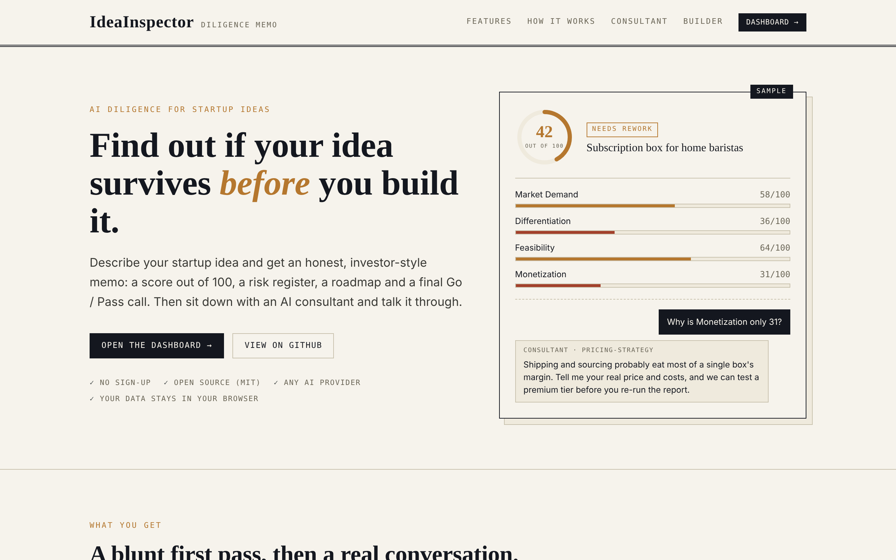</a>

</div>

<br>

## Why IdeaInspector?

Most startup ideas do not fail because the founder was lazy. They fail because nobody asked the hard questions early: *Is anyone actually asking for this? Why would they pick me? How does it make money? What could kill it?*

IdeaInspector asks those questions for you in minutes, with the bluntness of a seasoned analyst, and then stays at the table. You can challenge the score, explain what the AI got wrong, ask for a pricing review or a go-to-market plan, and watch your report get sharper as your thinking does.

It is built to **reject weak ideas fast and sharpen promising ones**, not to flatter you.

<br>

## See it in action

<div align="center">

[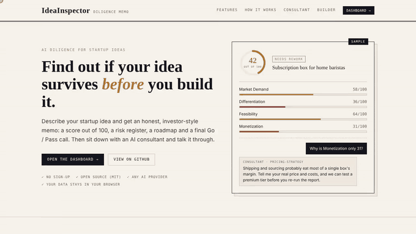](docs/demo.mp4)

**[▶ Watch the full demo video (MP4, 77 seconds)](docs/demo.mp4)**

<sub>The demo uses a sample idea ("RoastCall") and sample data to show how the platform feels. Your own reports will reflect your idea and your chosen AI model.</sub>

</div>

<br>

## How it works

| | | |
|:--:|---|---|
| **1** | **Describe your idea** | Write it in plain words. Add links, a pitch PDF or images if you have them. |
| **2** | **Get your report** | A scored diligence memo appears in moments: verdict, category scores, market, risks, roadmap and a final Go / Pass call. |
| **3** | **Talk to the consultant** | Open a chat on your report. Ask why the score is what it is, push back, or request a framework like SWOT or pricing. |
| **4** | **Re-run when it clicks** | Once the consultant truly understands your idea, refresh the **same report** from the chat and watch the score move. |

<br>

## Everything you get

<table>
<tr>
<td width="50%" valign="top">

### 📋 A report you can defend
Score out of 100, category breakdown, target customer and competitors, business model verdict, risk register, strengths and weaknesses, do and don't lists, a phased roadmap, comparable companies, investor readiness and a final verdict. Every report states how it was scored and how confident it is.

</td>
<td width="50%" valign="top">

### 💬 A consultant that knows your report
Chat about your idea with an AI consultant that has read your entire report. It explains the score honestly, fixes misunderstandings, and brings real consulting frameworks to your specific idea, not generic advice.

</td>
</tr>
<tr>
<td valign="top">

### 🔁 Reports that improve, not pile up
Start as many chats as you like on one report. When your idea is finally understood, re-run it in place. The same report updates, with no clutter of old copies, and shows how much the score changed.

</td>
<td valign="top">

### 🧰 A full consulting toolkit
Sixteen consulting skills (market research, competitive analysis, pricing, unit economics, risk, innovation and more), one-click quick actions such as SWOT, market scan, competitor profiles and go-to-market plans, and industry-specific guidance.

</td>
</tr>
<tr>
<td valign="top">

### 📄 Download and share
Export a full PDF memo with clickable sources, or a crisp one-page summary, ready for a mentor, co-founder or investor.

</td>
<td valign="top">

### 🔌 Your AI, your choice
Works with Claude, GPT, Gemini, Llama, DeepSeek, Mistral, Grok, OpenRouter, local models and more. Paste your own key and choose any model you like.

</td>
</tr>
<tr>
<td valign="top">

### 🔒 Private by design
No account. Your reports and chats stay in your own browser, and your key is never stored on a server. Export a backup whenever you want.

</td>
<td valign="top">

### 📱 Works everywhere
A clean, fast interface on desktop, tablet and phone.

</td>
</tr>
</table>

<br>

## A look inside

<table>
<tr>
<td width="50%" align="center">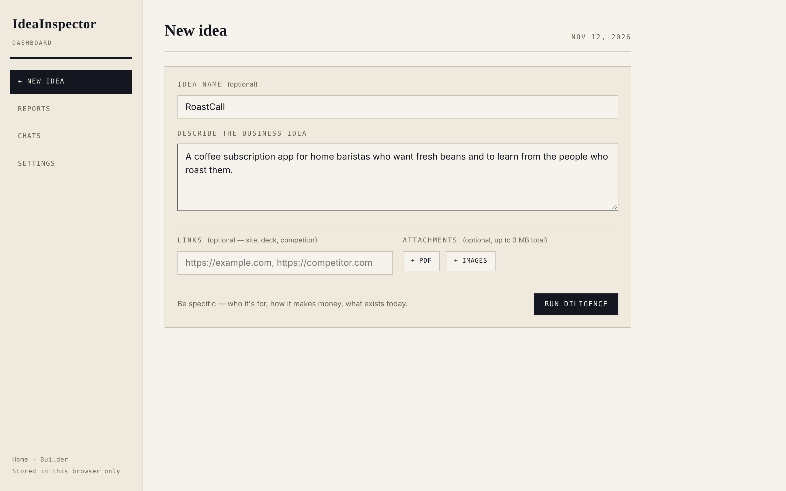<br><sub><b>Describe your idea</b><br>Plain words, optional links and attachments</sub></td>
<td width="50%" align="center">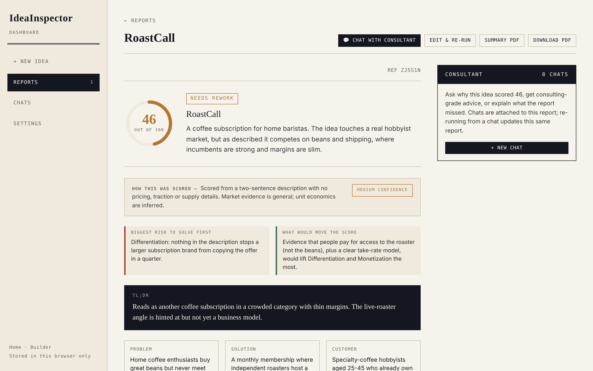<br><sub><b>Get an honest report</b><br>Score, confidence and the biggest risk first</sub></td>
</tr>
<tr>
<td align="center">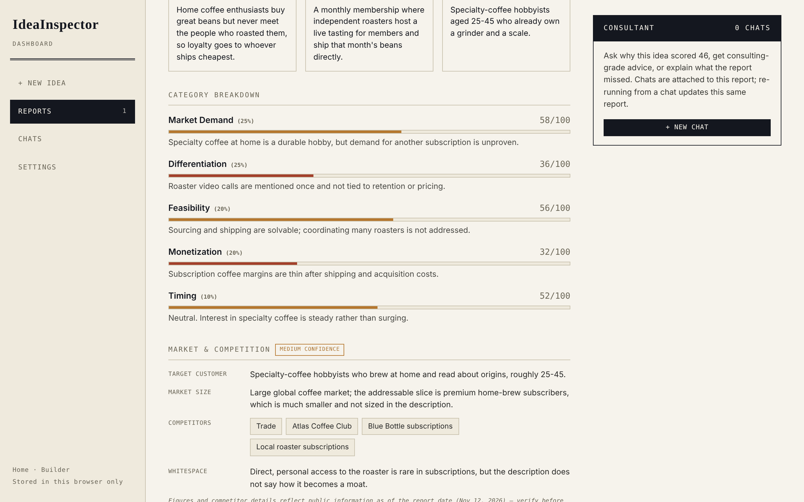<br><sub><b>See exactly why</b><br>Every category scored, with reasons</sub></td>
<td align="center">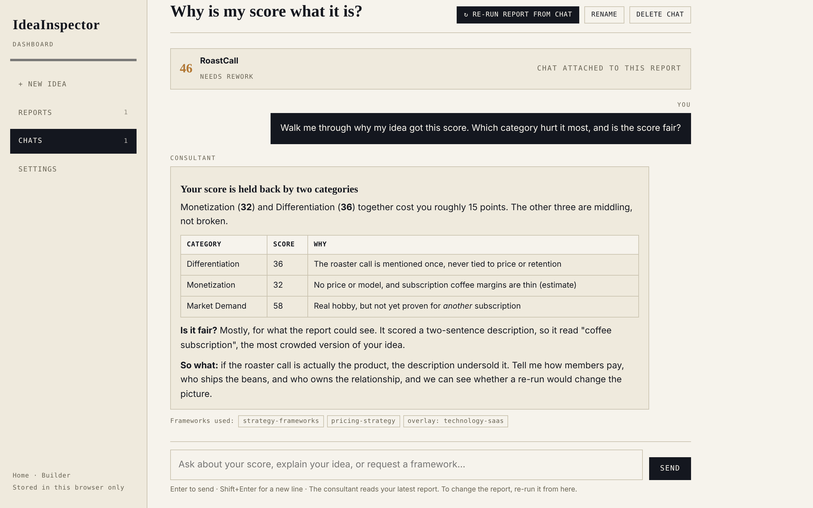<br><sub><b>Ask the consultant</b><br>It explains your score and shows the frameworks it used</sub></td>
</tr>
<tr>
<td align="center">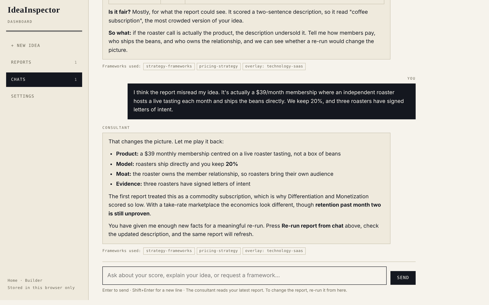<br><sub><b>Fix what the AI got wrong</b><br>It plays your idea back before anything is re-scored</sub></td>
<td align="center">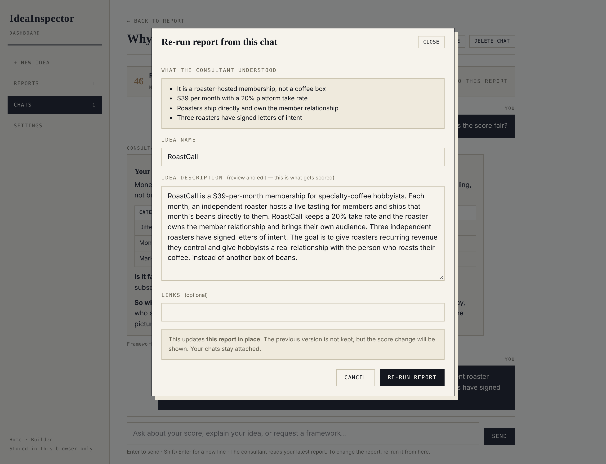<br><sub><b>Review, then re-run</b><br>You approve the updated description first</sub></td>
</tr>
<tr>
<td align="center">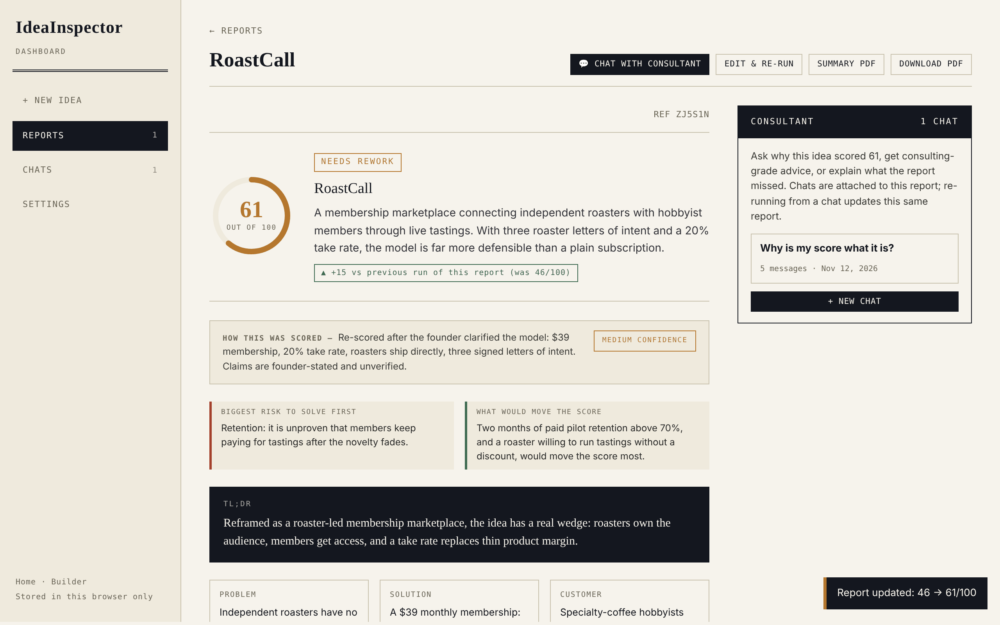<br><sub><b>Same report, sharper score</b><br>Updated in place, with the change shown</sub></td>
<td align="center">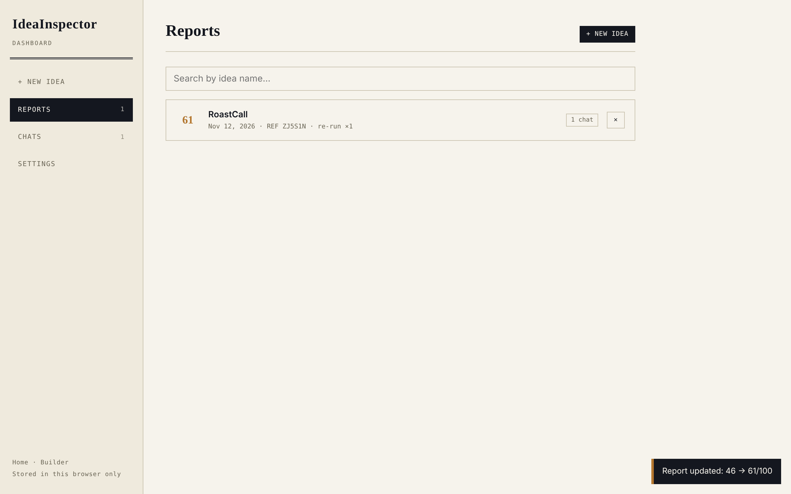<br><sub><b>All your reports, one place</b><br>Open, search, download or delete any time</sub></td>
</tr>
</table>

<div align="center">
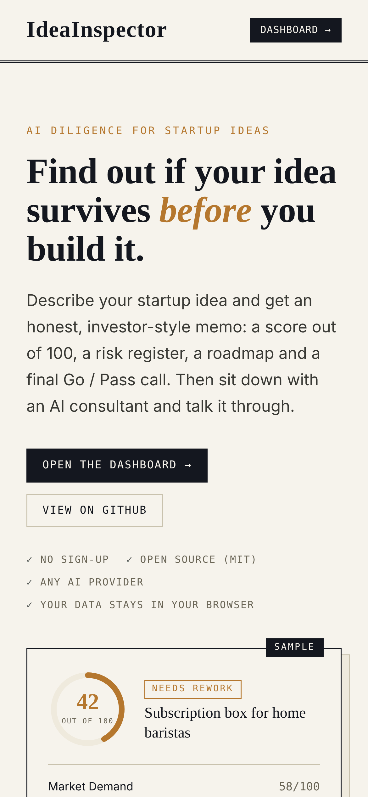
&nbsp;&nbsp;
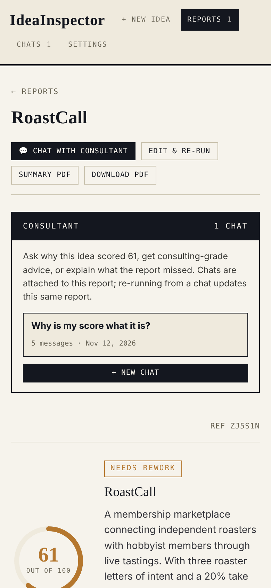
<br><sub>Looks and works great on your phone too</sub>
</div>

<br>

## Who is it for?

IdeaInspector is for anyone who has an idea and wants a sharp, unbiased second opinion before spending months or money on it.

| If you are... | IdeaInspector helps you... |
|---|---|
| 🎓 **A student or first-time founder** | Turn a rough idea into something structured, learn how investors think, and avoid building something nobody wants. |
| 🚀 **A hackathon or side-project team** | Pick the idea with the strongest legs *before* the weekend starts. |
| 🧑‍💻 **An indie hacker or solo builder** | Pressure-test a product idea in minutes instead of weeks, and decide what to validate first. |
| 🏫 **A college E-Cell, incubator or accelerator** | Give every applicant fast, consistent first-pass feedback, and a common language for discussing ideas. |
| 💼 **An angel investor or scout** | Run a quick first screen on pitches and see the key risks and open questions up front. |
| 🧭 **A product manager or intrapreneur** | Stress-test a new product or feature concept before pitching it internally. |
| 🛠️ **A freelancer, consultant or agency** | Help clients shape and challenge their ideas with ready-made frameworks and a clean PDF to share. |
| 📚 **An educator or mentor** | Use real reports and the consultant chat to teach entrepreneurship, one idea at a time. |

<br>

## What you can ask the consultant

> *"Walk me through why my idea scored 46. Is that fair?"*
> *"The report misunderstood my idea. Let me explain what it really is."*
> *"If I could fix only one thing this month, what should it be?"*
> *"Run a SWOT on this."* &nbsp;·&nbsp; *"Who are my real competitors, and how do I beat them?"*
> *"Is my pricing right? Suggest a better structure."* &nbsp;·&nbsp; *"Build me a 90-day go-to-market plan."*
> *"What are the biggest risks, and how do I reduce them?"*

<br>

## Honest by design

IdeaInspector will tell you what you need to hear, not what you want to hear.

- A **low score with clear reasons** is a reliable signal: fix those things or move on.
- A **high score** is a hypothesis worth testing with real customers, not a guarantee.
- It reads your description and public information. It has **not** talked to your customers, so treat it as a first-pass analyst, not investment advice.

<br>

## Get started in a minute

1. Open **[idea-inspector.vercel.app](https://idea-inspector.vercel.app/)** and click **Dashboard**.
2. In **Settings**, pick an AI provider, paste your key and choose a model. Press **Test connection**.
3. Click **New idea**, describe it, and run your first report.

<details>
<summary><b>Want your own copy? Run it locally or deploy it.</b></summary>

<br>

**Run locally** (needs [Node.js](https://nodejs.org) 18+, nothing to install):

```bash
git clone https://github.com/Bharat2456/IdeaInspector.git
cd IdeaInspector
npm start
```

Then open http://localhost:3000.

**Deploy on Vercel:** import the repository at [vercel.com/new](https://vercel.com/new) and click **Deploy**. No settings or environment variables are needed. Please do not set a server-side API key on a public deployment, or everyone who visits will use yours.

</details>

<br>

## Meet the builder

<table>
<tr>
<td width="140" align="center" valign="top"></td>
<td valign="top">

**Bharat Wagh**, a curious builder and Computer Engineering student in Pune who loves turning ideas into working products. IdeaInspector exists because every builder deserves an honest second opinion.

Open to new ideas and freelance projects, so feel free to connect.

[LinkedIn](https://www.linkedin.com/in/bharat-wagh-96b3082a8) · [GitHub](https://github.com/Bharat2456) · [Instagram](https://instagram.com/doppelganger.bharat) · [X](https://x.com/BharatWagh1010) · [Builder page](https://idea-inspector.vercel.app/builder)

</td>
</tr>
</table>

<br>

## Credits and licence

Released under the [MIT licence](LICENSE), free to use, fork and build on. The consultant's frameworks come from the open-source [business-consulting](https://github.com/abinauv/business-consulting) skill pack by Abi (MIT).

<div align="center">
<br>

**If IdeaInspector helps you, please give it a ⭐ and share it with someone who has an idea.**

<a href="https://idea-inspector.vercel.app/"><b>Try it now → idea-inspector.vercel.app</b></a>

</div>
